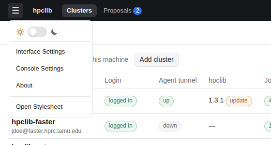
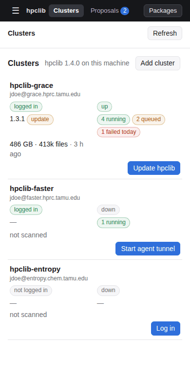

# Using the interface

The tunnel manager, also called the Agent Console, is a web page served by a small program on your own machine.
It runs hpclib's commands for you: it logs in to clusters, installs and sets them up, starts and stops tunnels,
opens apps in your browser, and shows what agents are doing. The page never sees your passwords or tokens; the
console program keeps them and talks to the clusters.

This section assumes hpclib is installed on your machine and `launch-tunnel-manager` is on your `PATH`
([Installation](../installation.md), step 1). Everything else, including installing hpclib on clusters, can be
done from the page.

1. [Getting started](getting-started.md): start the console, add a cluster, log in, connect an LLM client.
2. [Agents](agents.md): the Clusters, Proposals, Activity, Files and Settings pages.
3. [Apps](apps.md): JupyterLab, VS Code, PAI, Data transfer, the Workspace (files, an editor, terminals and job
   submission), and apps added from packages.
4. [Clusters](clusters.md): one page per cluster, with its apps, jobs, what is installed, storage, files and agents.
5. [The console menu](console-settings.md): dark mode, Interface Settings, Console Settings (notifications, ports,
   LLM clients, defaults for new clusters) and About.

## How the page is laid out

The **top bar** holds what spans clusters: **Clusters**, the home page, with one row per cluster;
**Proposals**, the templates agents proposed on any cluster, with a count; and, on the right, **Packages**,
which lists and installs packages. The **☰** menu at the far left has what belongs to this machine: the dark-mode
switch, Interface Settings, Console Settings and About.

The page fits a phone too, which is handy for approving a Duo push or checking a job away from your desk:

Everything else is on a cluster's page: its Overview, Jobs, Apps (each app has its own page there, with its
settings), Installed, Storage, Files, Agents and Settings tabs. See [Clusters](clusters.md).

Rows refresh themselves: every few seconds while something is happening (a login, a tunnel starting, an
install), and every 30 seconds otherwise. You don't need to reload the page to follow a tunnel.

## What the console keeps, and where

| What | Where on your machine |
| --- | --- |
| the session key for the page | `~/.config/hpclib/console/session` (new at each launch) |
| each cluster's profile and tokens | `~/.config/hpclib/agents/USER@HOST/` |
| tunnel and app logs | `~/.config/hpclib/console/logs/` |
| installed packages | `~/.config/hpclib/console/packages/` |

The console listens only on `127.0.0.1` and refuses requests without the session key, so other users of your
machine and other web pages can't use it.
