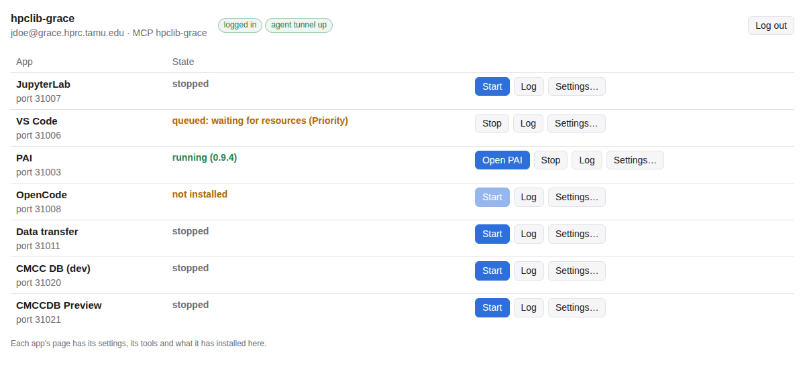
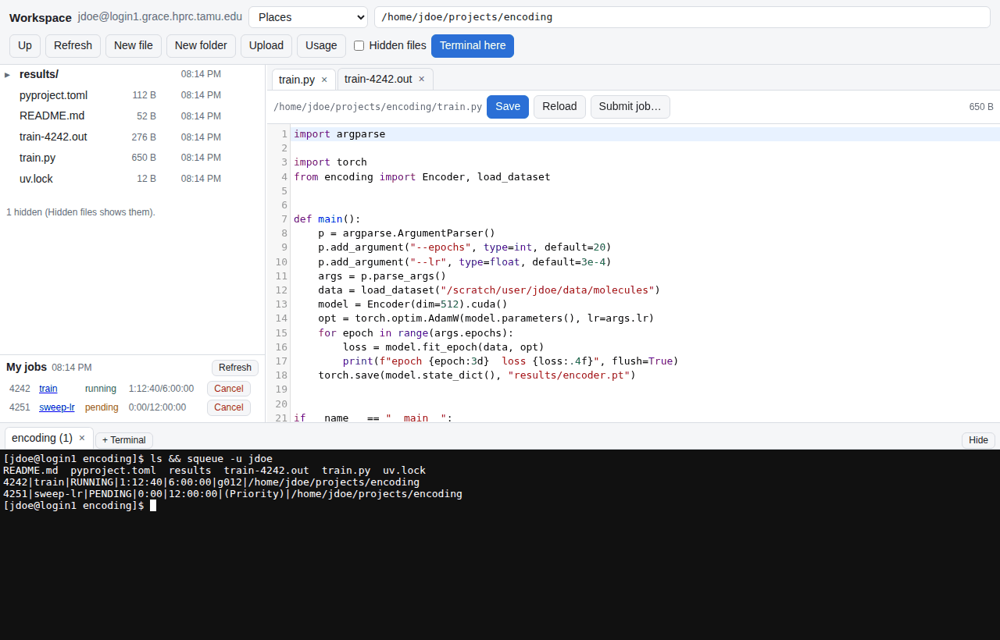
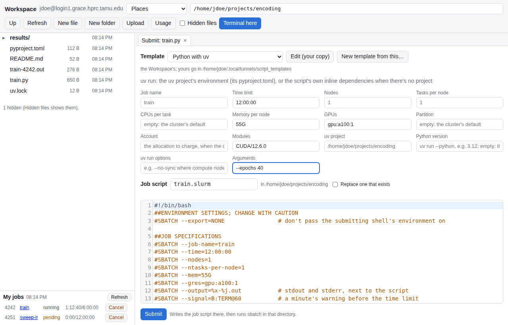
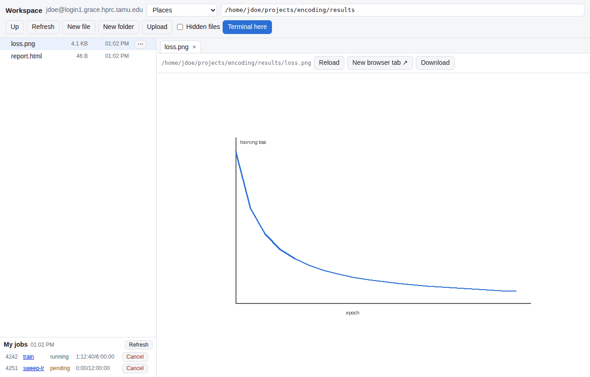
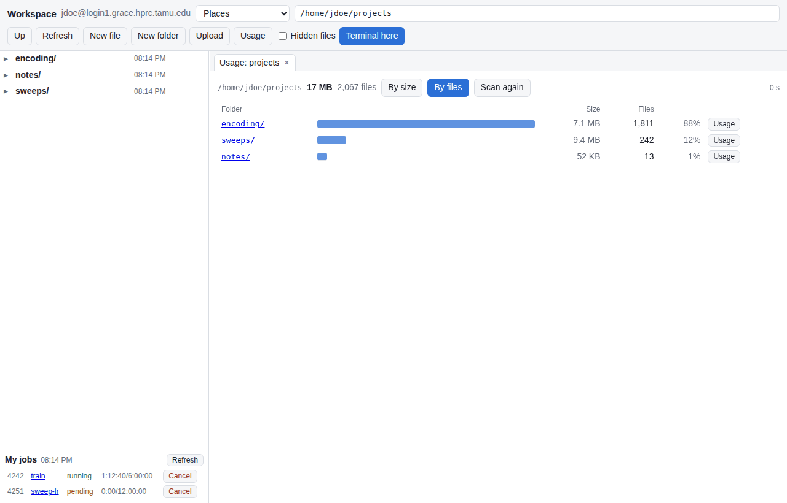

# Apps in the interface

Besides the agents' tunnel, the console runs **apps**: programs on a cluster that you open in your browser. Each
app has a **Sessions** page with one row per cluster. Apps use the same clusters and the same ssh login as the
Agents pages, so add a cluster and log in there first ([Getting started](getting-started.md), steps 2 and 3).
You don't need to set a cluster up for agents to use its apps.

## A session row

| Element | What it does |
| --- | --- |
| state | **not installed** (until **Install** in Settings…), **stopped**, **starting**, **queued** (with SLURM's reason), **running**, **error** |
| **Start** | start the app's tunnel; for most apps this submits a SLURM job |
| **Open** | open the app in a new browser tab, signed in where the app allows it |
| **Stop** | end the tunnel and cancel its job |
| **Log** | the tunnel's and the job's output |
| **Settings…** | whether the app is installed (with **Check** and **Install**), the job's resources and the app's own settings for this cluster |



**Start** is refused while the app is known to be missing on the cluster: open **Settings…** and **Install** first.

### Install

The top of the Settings panel says whether what the app needs is installed on the cluster (**installed**, **not
installed**, **install status unknown**) and what the cluster reported, such as the image's path. It is checked
automatically once you are logged in.

| Button | What it does |
| --- | --- |
| **Check** | check again (runs the tunnel's `install.sh --check` on the cluster) |
| **Install** / **Reinstall** | install what the app needs; its output appears under the row. Some apps call this **Update** once installed |

When an installer reports that it cannot run on the login node (PAI needs Singularity or Apptainer to pull
images), the console continues it through the cluster's REST API. Start the agent tunnel first; its REST job
must be running. Install and Update retain their progress log and final status. This requires HPCLIB 0.2.71
on your machine and the cluster; after updating the cluster, restart its agent tunnel.

Each app on each cluster gets ports of its own, chosen once and kept, so apps never collide with each other,
with the agents' tunnel or with other users. Starting an app on a port an earlier session left behind clears
that port first; see [Ending tunnels](../architecture.md#ending-tunnels-and-stale-ports).

### Settings

The settings form has up to three parts:

- **Job**: time limit, memory, CPUs and partition for the app's SLURM job.
- **App settings**: the tunnel's own settings, such as where VS Code's container image is kept. They are saved
  on the cluster (`~/.local/tunnels/settings/TUNNEL.sh`) the next time you Check, Install or Start, so the
  job and the installer use the same values. A blank field means the tunnel's default; a package's default
  shows as the placeholder.
- **Secrets** (only apps that declare them): password fields. Values go to the cluster over the ssh login on
  standard input and are stored there in a private file; the console keeps only whether each is set.

Settings apply the next time the app starts.

### Second password prompts

When the app's job starts, the login node connects to the compute node SLURM gave it. On some clusters that asks
for your password again, and the first time a new compute node is reached, ssh asks whether to trust its host
key. The page notices either prompt and opens a dialog wherever you are. **Not now** leaves a reminder on the
row.

## JupyterLab

Runs JupyterLab in a SLURM job. **Open** goes straight in with the token Jupyter printed.

Settings: the conda environment to activate, modules to load first, or a uv/pixi project directory whose
environment has JupyterLab. **Check** looks for `jupyter` there. With a project set, **Install** adds JupyterLab
to it (`pixi add` in a pixi project, otherwise a uv environment in `PROJECT/.venv`); for a conda environment or
modules, install JupyterLab there yourself.

## VS Code

Runs code-server (VS Code in the browser) from a Singularity image in a SLURM job. **Install** pulls the image.
code-server asks for a password: **Copy password** copies it, then **Open**.

Settings: where the image is kept (`VSCODE_CONTAINER`), the start directory, and directories to bind into the
container.

## PAI

The proto-auto-interface database and its web interface. It is **shared**: Start connects to a database job
that is already running (yours or one another tunnel started), and only submits a new one if there is none. The
row's toolbar names the job serving the database and whether this tunnel started it.

- **Stop** only disconnects; the database job keeps running for the next session.
- **End database job** cancels that job (after asking).
- Once installed, the install button is **Update**: it fast-forwards the checkout from its git remote and pulls
  the app's image again. A running database job keeps the old code until you end it and Start again.

Settings: the install directory, the repository to clone, the image to pull, whether development endpoints are
on, and **Bind source** (run your checkout's code instead of the image's).

## Data transfer

Command-line and agent transfers use Samba's `smbclient` with a private Kerberos ticket. The rclone web GUI is optional.

- **Install** pulls the data-transfer-tools image, which supplies both clients.
- **Sign in for transfers** creates the ticket without opening a GUI. Your account password is not saved.
  A failed sign-in preserves the previous ticket. A sign-in in another shell can use a host-only cache;
  the page distinguishes that from the transfer sign-in.
- **Start** opens the optional GUI on the cluster's login node through your SSH connection. It asks for your
  account password once, creates the transfer ticket automatically, and configures rclone to use a password
  for that GUI session. Its private configuration is kept on a memory filesystem and removed on Stop or a
  normal session exit. The GUI refuses to put the session password in a disk-backed temporary directory.
- **Open** opens the running GUI with its generated browser login. Those browser credentials are separate
  from your account password. **Stop** ends the GUI; the transfer ticket remains available to CLI and agents.
- **Sign out of transfers** removes that ticket. Otherwise it expires normally; it is not renewed indefinitely.
- **Check connection** checks access to the configured folder with `smbclient`; a ticket alone does not prove
  that the storage server accepts it or grants folder access.

Saved-password sign-in is retired. If an older password file exists, **Remove old saved password** removes it.
Neither CLI transfers nor agents use it. The GUI always asks for a fresh session password.

**Agents and the SMB server.** Enable **list** and **get** per cluster on its **Agents** tab; **put** remains off
until the owner enables it. All three use `smbclient` and the transfer ticket, independently of the GUI. Copies
run as SLURM jobs and retain the existing scoped staging path checks. The ticket must outlive a queued/running job.

Settings include the SMB server, share/folder, user name, GUI password domain, Kerberos realm and service name,
optional GUI and image location. A short service identity such as `cifs/netapp-res-01` can be configured separately
from the full connection hostname. With blank realm/service settings, transfers use their ticket's realm and
try the short service name once after a definite unknown-principal response on a read-only probe, retaining
the original server's network destination. Explicit settings take precedence. Existing encryption policy remains
in force; client changes do not repair missing service identities or AES configuration on the storage/domain side.

## Workspace (a package)

Your files on a cluster in the browser: a file list, an editor, viewers, terminals and job submission. It comes
with hpclib as a package (`packages/workspace`): **Packages → Come with hpclib → Workspace → Install…**, then
**Install**. It then has a row on each cluster's Apps tab. It needs Python 3.6 or newer on the login node and
nothing else (**Check** says which Python it will use).

- **Start** runs its server on the cluster's **login node** (no job), as you, with your full permissions; it is
  not the agents' sandbox. It listens on the login node's 127.0.0.1 only and answers only with the token it
  prints at start, which **Open** adds (a login node is shared: anyone on it could reach the port).
- **Files**: browse (**Places** has your home and scratch directories), **New file**, **New folder**,
  **Upload** (or drop files on the list), and from each entry's **⋯** menu: Rename, Delete (a file or an empty
  folder), Download, Copy path, Terminal here, and **Submit job…** for a Python or bash script.
- **Editor**: text files open in CodeMirror, with syntax highlighting for Python, shell, YAML, TOML, JSON,
  Markdown, C/C++, Fortran, R, Julia and more. **Save** (or Ctrl/⌘-S) refuses to overwrite a file someone
  changed on the cluster since you opened it, and asks first. Files up to **Editor limit** (800 MB by default)
  open; above **Ask above** (20 MB) it asks first.
- **Viewers**: images and SVG, HTML pages (their scripts run, sandboxed, and relative links to their images
  work), PDFs and movies (they seek). **Edit source** opens an HTML or SVG file in the editor.
- **Terminals**: **Terminal here** opens your login shell in the current folder (xterm.js), as many as you like,
  below the files. They end with the Workspace (Stop) or when you close their tab.
- **My jobs**: your queued and running jobs (`squeue`), with Cancel; a job's name opens its folder.
- **Usage** (and **Disk usage** in a folder's **⋯** menu): the folder's folders by size (`du -k`) and by file count
  (`du --inodes`: files, folders and links, what a file quota counts), as the cluster's Storage tab shows them,
  for any folder; **By size** and **By files** sort them, and each row opens the folder or its own usage. It runs
  at low priority for up to two minutes (then it says it is partial).



**Submit job…** builds a job script from a **script template** and submits it with `sbatch` in the file's folder.
The templates that come with it run a Python script with **uv** (`uv run` in the project with the
`pyproject.toml`, or with the script's inline dependencies), with **pixi** (`pixi run` in a pixi project), with
**modules, a venv or conda**, or run a **bash** script. Each has a form (time limit, nodes, tasks, CPUs, memory,
GPUs, partition, account, modules, and its own fields). The job script beside it follows the form as you type,
and you can edit it by hand before **Submit**. The values you used last on a cluster are filled in next time.
Every template sources your `~/.bashrc` (jobs start with `--export=NONE`) and hpclib, and uses
`slurm_job_info` and `slurm_job_footer`; output goes to `JOBNAME-JOBID.out` beside the script.



**Edit (your copy)** copies a template to `~/.local/tunnels/script_templates/` on the cluster and opens it; yours
replace the Workspace's of the same name, and **New template from this…** starts another. A template is the job
script with a header that declares its form, `{{name}}` for a field's value (or the file's: `input`, `input_stem`,
`dir`, `hpclib`, `user`, `home`), and lines starting `{{?name}}` that are kept only when that field isn't empty:

```bash
#!/bin/bash
#@ title: Python on a GPU
#@ for: .py
#@ field time: Time limit | 6:00:00
#@ field gres: GPUs | gpu:a100:1
#SBATCH --time={{time}}
{{?gres}}#SBATCH --gres={{gres}}
python -u "{{input}}"
```

The page loads CodeMirror and xterm.js from jsDelivr: your browser needs to reach it (the cluster doesn't). For a
site without it, set **CDN** in the Workspace's settings to a mirror of npm packages; without them the editor is a
plain text box and terminals don't open.





## Adding apps and settings from packages

Apps that don't belong in hpclib itself (a group's file server, a project's test instance) come as **package**
zip files. Click **Packages** at the top right:

1. Choose the zip, or one of the packages that **come with hpclib** (its clone's `packages/` folder, such as the
   Workspace). The console checks it and shows what it adds: apps, tunnels, and default settings with their
   values.
2. **Install** it. Its apps join each cluster's Apps tab.
3. The packaged tunnel and settings files go to a cluster the next time you Check, Install or Start the app
   there.

The same dialog lists installed packages and removes them. A package can't replace hpclib's own apps or another
package's. Its scripts run on your clusters as you, so install only packages you trust.

To build one, see [Extending hpclib](../extending.md#console-packages).
