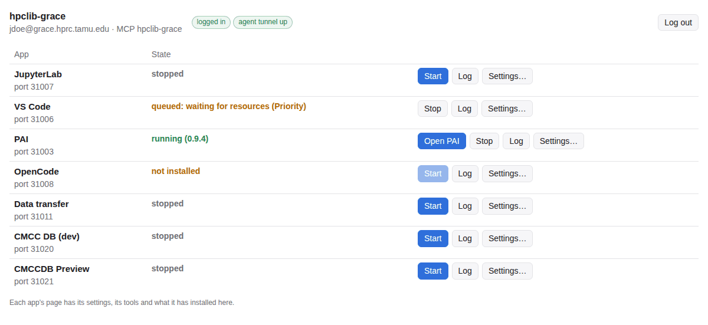
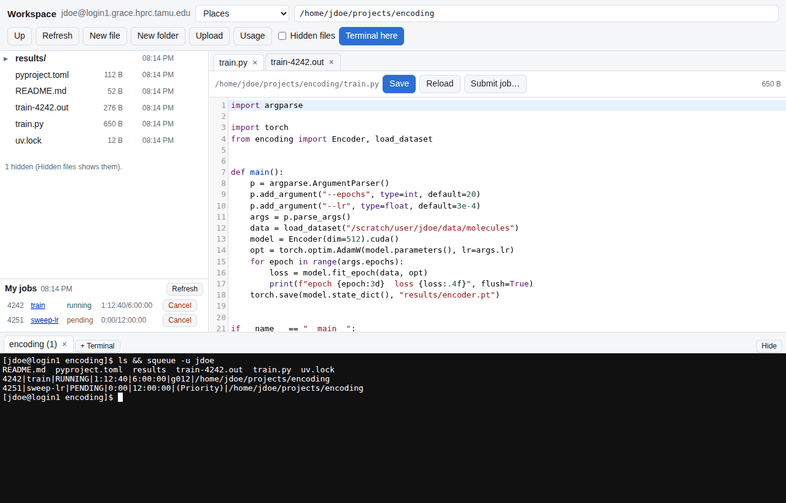
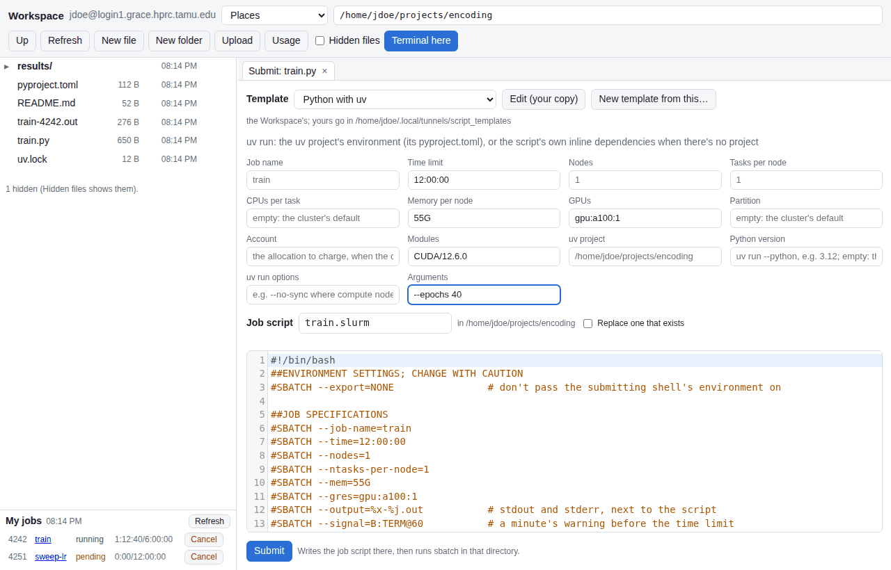
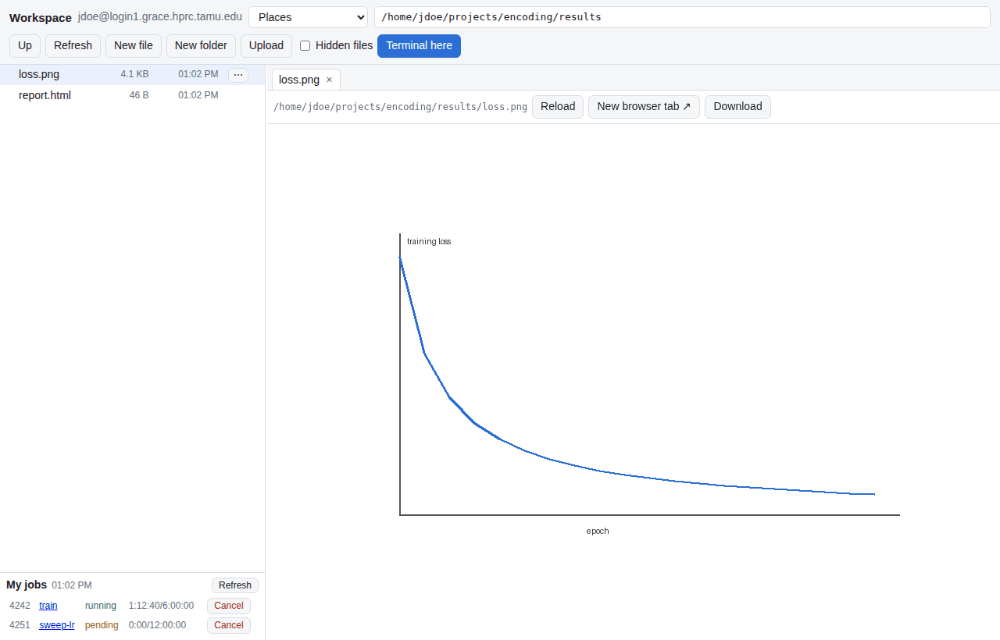
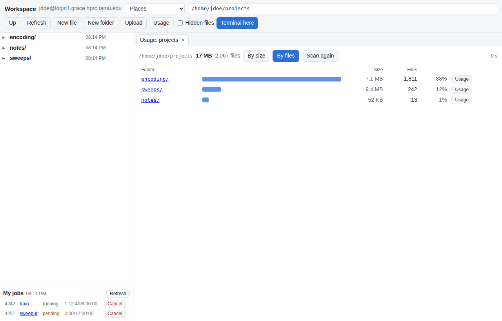

# Apps in the interface

Besides the agents' tunnel, the console runs **apps**: programs on a cluster that you open in your browser. Each
app has a **Sessions** page with one row per cluster. Apps use the same clusters and the same ssh login as the
Agents pages, so add a cluster and log in there first ([Getting started](getting-started.md), steps 2 and 3).
You don't need to set a cluster up for agents to use its apps.

## A session row

| Element | What it does |
| --- | --- |
| state | **not installed** (until **Install** in Settings…), **stopped**, **starting**, **queued** (with SLURM's reason), **running**, **error** |
| **Start** | start the app's tunnel; for most apps this submits a SLURM job |
| **Open** | open the app in a new browser tab, signed in where the app allows it |
| **Stop** | end the tunnel and cancel its job |
| **Log** | the tunnel's and the job's output |
| **Settings…** | whether the app is installed (with **Check** and **Install**), the job's resources and the app's own settings for this cluster |



**Start** is refused while the app is known to be missing on the cluster: open **Settings…** and **Install** first.

### Install

The top of the Settings panel says whether what the app needs is installed on the cluster (**installed**, **not
installed**, **install status unknown**) and what the cluster reported, such as the image's path. It is checked
automatically once you are logged in.

| Button | What it does |
| --- | --- |
| **Check** | check again (runs the tunnel's `install.sh --check` on the cluster) |
| **Install** / **Reinstall** | install what the app needs; its output appears under the row. Some apps call this **Update** once installed |

When an installer reports that it cannot run on the login node (PAI needs Singularity or Apptainer to pull
images), the console continues it through the cluster's REST API. Start the agent tunnel first; its REST job
must be running. Install and Update retain their progress log and final status. This requires HPCLIB 0.2.71
on your machine and the cluster; after updating the cluster, restart its agent tunnel.

Each app on each cluster gets ports of its own, chosen once and kept, so apps never collide with each other,
with the agents' tunnel or with other users. Starting an app on a port an earlier session left behind clears
that port first; see [Ending tunnels](../architecture.md#ending-tunnels-and-stale-ports).

### Settings

The settings form has up to three parts:

- **Job**: time limit, memory, CPUs and partition for the app's SLURM job.
- **App settings**: the tunnel's own settings, such as where VS Code's container image is kept. They are saved
  on the cluster (`~/.local/tunnels/settings/TUNNEL.sh`) the next time you Check, Install or Start, so the
  job and the installer use the same values. A blank field means the tunnel's default; a package's default
  shows as the placeholder.
- **Secrets** (only apps that declare them): password fields. Values go to the cluster over the ssh login on
  standard input and are stored there in a private file; the console keeps only whether each is set.

Settings apply the next time the app starts.

**Presets.** Under the form, **Presets** keeps named sets of these choices for this app on this cluster (for
example "Big memory" with 64 GB and a longer time limit, or "Quick look" with one CPU). Choose one to fill the
form, then **Save** to make it the app's settings. Type a name and **Save as preset** to store what the form
holds now (an existing name is replaced); **Delete preset** removes the chosen one. At most 20 per app.

**What the cluster already has.** The first time the console checks, installs or starts an app on a cluster
(asked once per console run, until the cluster has answered), it reads what the cluster's settings file already
holds and takes those values as its own wherever it has none, so a new computer or a lost profile doesn't blank
them on the first save. Values the console already has are kept; the form lists what was taken. The job's
options (time, memory, partition) are not saved on the cluster, so they can't be read back. It needs a cluster
whose hpclib has `setup_tunnel.sh --saved` (Agents → Clusters → Update hpclib); an older one is just not asked.

### Second password prompts

When the app's job starts, the login node connects to the compute node SLURM gave it. On some clusters that asks
for your password again, and the first time a new compute node is reached, ssh asks whether to trust its host
key. The page notices either prompt and opens a dialog wherever you are. **Not now** leaves a reminder on the
row.

## JupyterLab

Runs JupyterLab in a SLURM job. **Open** goes straight in with the token Jupyter printed.

Settings: the conda environment to activate, modules to load first, or a uv/pixi project directory whose
environment has JupyterLab. **Check** looks for `jupyter` there. With a project set, **Install** adds JupyterLab
to it (`pixi add` in a pixi project, otherwise a uv environment in `PROJECT/.venv`); for a conda environment or
modules, install JupyterLab there yourself.

More settings: **Start directory** (what the file browser opens in; default `/`, and a missing folder falls
back to `/` with a warning in the job's log), **Data directory** (`JUPYTER_DATA_DIR`: kernels, extensions) and
**Config directory** (`JUPYTER_CONFIG_DIR`: Jupyter's settings), for keeping them off a small home quota.

## VS Code

Runs code-server (VS Code in the browser) from a Singularity image in a SLURM job. **Install** pulls the image.
code-server asks for a password: **Copy password** copies it, then **Open**.

Settings: where the image is kept (`VSCODE_CONTAINER`), the start directory, and directories to bind into the
container, plus:

- **Extensions and settings** (`VSCODE_DATA_DIR`, default `START_DIRECTORY/.code-server-data`): passed to
  code-server as `--user-data-dir DIR/user-data` and `--extensions-dir DIR/extensions`, so what you install and
  set survives between jobs and lives where you chose. The directory is bound into the container unless a
  bind already covers it.
- **Folder to open** (`VSCODE_START_FOLDER`): opened every time; blank opens the one you had open last.
- **Image version** (`VSCODE_IMAGE_TAG`, default `latest`): the `codercom/code-server` tag. Install pulls it and
  records it beside the image (`vscode.sif.tag`); Check reports "not installed" when the image there is
  another tag, and **Install** replaces it. An image from before tags counts as `latest`.

Environment variables and other settings of the terminals inside VS Code are not managed here.

## PAI

The proto-auto-interface database and its web interface. It is **shared**: Start connects to a database job
that is already running (yours or one another tunnel started), and only submits a new one if there is none. The
row's toolbar names the job serving the database and whether this tunnel started it.

- **Stop** only disconnects; the database job keeps running for the next session.
- **End database job** cancels that job (after asking).
- Once installed, the install button is **Update**: it fast-forwards the checkout from its git remote and pulls
  the app's image again. A running database job keeps the old code until you end it and Start again.

Settings: the install directory, the repository to clone, the image to pull, whether development endpoints are
on, and **Bind source** (run your checkout's code instead of the image's).

## Data transfer

Command-line and agent transfers use Samba's `smbclient` with a private Kerberos ticket. The rclone web GUI is optional.

- **Install** pulls the data-transfer-tools image, which supplies both clients.
- **Sign in for transfers** creates the ticket without opening a GUI. Your account password is not saved.
  A failed sign-in preserves the previous ticket. A sign-in in another shell can use a host-only cache;
  the page distinguishes that from the transfer sign-in.
- **Start** opens the optional GUI on the cluster's login node through your SSH connection. It asks for your
  account password once, creates the transfer ticket automatically, and configures rclone to use a password
  for that GUI session. Its private configuration is kept on a memory filesystem and removed on Stop or a
  normal session exit. The GUI refuses to put the session password in a disk-backed temporary directory.
- **Open** opens the running GUI with its generated browser login. Those browser credentials are separate
  from your account password. **Stop** ends the GUI; the transfer ticket remains available to CLI and agents.
- **Sign out of transfers** removes that ticket. Otherwise it expires normally; it is not renewed indefinitely.
- **Check connection** checks access to the configured folder with `smbclient`; a ticket alone does not prove
  that the storage server accepts it or grants folder access.

Saved-password sign-in is retired. If an older password file exists, **Remove old saved password** removes it.
Neither CLI transfers nor agents use it. The GUI always asks for a fresh session password.

**Agents and the SMB server.** Enable **list** and **get** per cluster on its **Agents** tab; **put** remains off
until the owner enables it. All three use `smbclient` and the transfer ticket, independently of the GUI. Copies
run as SLURM jobs and retain the existing scoped staging path checks. The ticket must outlive a queued/running job.

Settings include the SMB server, share/folder, user name, GUI password domain, Kerberos realm and service name,
optional GUI and image location. A short service identity such as `cifs/netapp-res-01` can be configured separately
from the full connection hostname. With blank realm/service settings, transfers use their ticket's realm and
try the short service name once after a definite unknown-principal response on a read-only probe, retaining
the original server's network destination. Explicit settings take precedence. Existing encryption policy remains
in force; client changes do not repair missing service identities or AES configuration on the storage/domain side.

### Directory sync setup (initial implementation stage)

**Data transfer → Directory sync** (`#/transfer/sync`) saves one local directory with multiple cluster targets.
In hpclib 1.14.0, a dedicated **Directory sync** panel appears above the SMB controls on both the cluster and
all-cluster Data transfer pages. Its primary **Manage directory syncs** link opens the setup/management page;
the cluster-specific link preselects that cluster. The all-cluster navigation also labels the page **Directory sync**.
The first implementation stage supports pair editing, configurable per-file/aggregate/file-count warning
thresholds, pause preferences, and local Git ignore setup. Transfers, snapshots, and heartbeat workers are not
enabled yet; the page says so and Run remains disabled. Git-only setup does not require or invoke rclone.
The compact editor and saved cards place the local and remote directories beside one another. Direction is
saved explicitly: bidirectional (↔), local to remote (→), or remote to local (←). Existing Git registrations
default to bidirectional; existing standalone rclone registrations retain their push/pull choice. Branch,
poll interval and warning thresholds are under **Advanced settings**.

**Ignore setup** shows the versioned default list. When `.gitignore` exists without `.hpclib-sync.json`, the page
first offers a reviewed default-rule merge. Declining offers sync-only exclusions; declining both records that
choice and keeps existing rules. An explicit final confirmation writes repository metadata and, only when chosen,
the displayed `.gitignore` change. Existing rule order/comments are preserved. Setup creates no commit and does
not change the ordinary Git index or checked-out branch. A changed file invalidates its setup preview.

Registrations live under the console's `sync/` directory. **Unregister** removes the active registration while
preserving working directories, repository metadata, and archived registration/history data.

**Agent sync context actions.** Data transfer also declares permanent cluster-side actions, independent of
the SMB login. Enable Data transfer under the cluster's **Agents → Tunnel actions** settings. Inspection
actions are then enabled by default; enable the two metadata-write actions individually when wanted.

| Action | Purpose |
| --- | --- |
| `sync_inspect` | Read metadata, effective warning thresholds and ignore choice from an existing scoped directory. |
| `sync_setup_preview` | Preview defaults and the proposed `.gitignore` merge; return a review token. |
| `sync_setup` | Save `gitignore`, `sync-only` or `off`, using the review token and `confirm: true`. |
| `sync_settings` | Change selected positive warning thresholds using a current review token and `confirm: true`; omitted or zero values stay unchanged. |

Each takes `root`, an existing directory in the token's work roots. Write actions require `files:write` and
server file changes enabled. They preserve unrelated ignore rules and refuse symlinked control files.
A changed setup file invalidates the review token. These actions manage portable metadata on the cluster;
local console registrations, pause preferences, commits and transfers are managed separately. No action here
starts a sync. The matching REST backend and Data transfer manifest must be installed together, then the
REST service restarted; replacing only the manifest on an older server is unsupported.

## Filesystem diagnostics (a package)

Finds out why tunnels are slow. Tunnel requests are slow when the file system calls behind them are: the REST server
stat-s, opens and lists files on a shared file system, and each call can wait on a busy server. It comes with hpclib
as a package (`packages/fsdiag`) but, unlike the Workspace, nothing installs it until you want it: **Packages → Come
with hpclib → Filesystem diagnostics → Install…**, then **Install**. It needs Python 3.6 or newer on the login node.
Like the Workspace it runs on the login node as you, listens on 127.0.0.1 only and answers only with the token
**Open** adds.

- **Probe**: choose **Where** (the login node, a compute node, or both) and **What to measure**. For compute nodes
  it submits one short SLURM job per target; leave the node list empty to let the scheduler pick, or choose nodes
  from the list (or from where your running jobs are, which is where a tunnel's REST server is) to test a node you
  suspect. Measuring is call latency at each place (home, scratch, the hpclib data directory, `/tmp` and
  `/dev/shm` as a node-local control, or places you list), how much your folders hold, and quota and inode use.
- **Results**: each run's findings first, in plain words with what to do, then the median time per call at each place
  with a column per node, so a node that differs from the others stands out, and what else was going on (load, I/O
  pressure, processes stuck on I/O). On NFS the findings say whether the server or this node's own queue is slow.
  **Download report** saves the text to attach to a message to your cluster's support.
- **Slow requests**: from the REST server's audit log and stack dumps (hpclib 1.13.13 and later, 1.13.14 for stacks):
  which routes are slow, how much of their time was waiting rather than computing, and which kind of call the stuck
  requests were inside (a file-system call, the job registry's SQLite file, searching `PATH`, writing the log).
- **Directories**: the survey of the folders you chose (entries per top-level folder, the largest directories, the
  slowest listings), inodes and space per place, and what the cluster's quota commands print.

**Agents can run it.** The package declares five [tunnel actions](../extending.md#tunnel-actions), so a model with
your REST token can run the diagnostics for you and read the findings (`list_tunnel_actions`, `run_tunnel_action`).
They are off until you turn them on: the cluster's **Agents** tab → **Tunnel actions** → Filesystem diagnostics. Each
runs as you, outside the agent's sandbox, and is in the Activity log.

| Action | What it does |
| --- | --- |
| `probe` | times file system calls on the node the REST server runs on (a compute node when it is a job: where tunnel requests are slow), about a minute; takes `repeats` |
| `survey` | counts the entries in a folder of the agent's work directories and reads the quota commands; takes `folder` and `seconds` |
| `requests` | what slow REST requests were waiting for, from the audit log; takes `hours` and `slow_ms` |
| `probe_node` | submits a short job doing `probe` on `node` (a name, or `any`); follow it with `job_status` or `wait_for_job`; its output is the report. Needs the `submit` scope |
| `probe_report` | prints a `probe_node` job's report by its job ID (the output file is in hpclib's protected data directory, which agents can't read) |

Each answers with the findings (severity, title, detail, what to do) and the text report. The job's partition,
account, time limit and memory are the app's settings.

From a shell, the same measurements are `python3 ~/.local/share/hpclib/tunnels/fsdiag/fsdiag_cli.py probe`, `requests`
or `all`; `probe` measures the node it runs on, so run it inside a job to measure a compute node.

**Settings** (the app's row on the Apps tab): the places to time, the folders to count, and the partition, account,
time limit and memory of the compute-node jobs. A probe creates files only inside a directory named
`.hpclib-fsdiag-HOST-PID` in each place and removes it again.

## Workspace (a package)

Your files on a cluster in the browser: a file list, an editor, viewers, terminals and job submission. It comes
with hpclib as a package (`packages/workspace`): **Packages → Come with hpclib → Workspace → Install…**, then
**Install**. It then has a row on each cluster's Apps tab. It needs Python 3.6 or newer on the login node and
nothing else (**Check** says which Python it will use).

- **Start** runs its server on the cluster's **login node** (no job), as you, with your full permissions; it is
  not the agents' sandbox. It listens on the login node's 127.0.0.1 only and answers only with the token it
  prints at start, which **Open** adds (a login node is shared: anyone on it could reach the port).
- **Files**: browse (**Places** has your home and scratch directories), **New file**, **New folder**,
  **Upload** (or drop files on the list), and from each entry's **⋯** menu: Rename, Delete (a file or an empty
  folder), Download, Copy path, Terminal here, and **Submit job…** for a Python or bash script.
- **Editor**: text files open in CodeMirror 6, with syntax highlighting for Python, shell, YAML, TOML, JSON,
  XML/HTML, CSS, C/C++, Java, Fortran, R, Julia, SQL and more. **Save** (or Ctrl/⌘-S) refuses to overwrite a file someone
  changed on the cluster since you opened it, and asks first. Files up to **Editor limit** (64 MB by default)
  open; above **Ask above** (20 MB) it asks first. Changes you haven't saved are kept in this browser and put back
  when you open the file again (after a reload or a crash), unless the file changed on the cluster since, when it asks.
- **Viewers**: images and SVG, HTML pages (their scripts run, sandboxed, and relative links to their images
  work), PDFs and movies (they seek). **Edit source** opens an HTML or SVG file in the editor.
- **Terminals**: **Terminal here** opens your login shell in the current folder (xterm.js), as many as you like,
  in a panel under the work area (drag its edge to resize it; **Hide** puts it away). A terminal keeps running when
  you reload the page or lose the connection: the page attaches again by itself and shows what it printed
  meanwhile. It ends when you close its tab, its shell exits, or the Workspace stops.
- **Layout and theme**: the file list, the work area and the terminal panel have draggable dividers (arrow keys
  work on them too; sizes are remembered), tabs of open files come back after a reload, and the page follows the
  console's theme, the dark switch and Interface Settings included, when you open it with the console's **Open**.
- **Links to a file**: the console opens the Workspace on a file with
  `#/c/CLUSTER/apps/workspace?file=/path/to/file&line=N` (`line` is optional), at the console's own address
  (`http://127.0.0.1:PORT/index.html#…`, the same address as the Files page's links), so a model can hand you a link
  like it does for the Files page. If the Workspace is running on that cluster, the link opens it straight away: the
  file's folder is shown in the file browser and the file opens in the editor (at that line), in front of the tabs you
  had. If it isn't running, the page says so, you start it there, and **Open** then goes to the file. Inside the
  Workspace, its own address takes `#file=/path&line=N` (and `#dir=/path` for a folder alone). A relative path is read
  from your home directory. A file that isn't there says so in its tab.
- **Runs**: the jobs you submitted from the Workspace, newest first, under the file list: **From here** (this
  folder and below) or **All**. Each shows its state and how long it ran, and has **Follow** (its output, live, in
  the panel below), **Script**, **Output** and, while it is queued or running, **Cancel**; its name opens its
  folder. Jobs submitted elsewhere are not listed (`squeue` in a terminal shows those). **Follow as it grows** in
  a file's **⋯** menu does the same for any file, and notices when a log is replaced.
- **Usage** (and **Disk usage** in a folder's **⋯** menu): the folder's folders by size (`du -k`) and by file count
  (`du --inodes`: files, folders and links, what a file quota counts), as the cluster's Storage tab shows them,
  for any folder; **By size** and **By files** sort them, and each row opens the folder or its own usage. It runs
  at low priority for up to two minutes (then it says it is partial).



The **Filter** box above the tree shows only the files and folders whose names match: `*` for any text, `?` for one
character, `[abc]` or `[a-c]` for a set, several patterns separated by spaces or commas (`*.py run_?.sh`), case ignored.
A folder stays only if its name matches and it isn't empty, or something inside it, at any depth, matches; the tree looks
inside folders in the background, so one can disappear a moment after you type. Escape clears the filter.

**Submit job…** asks for what the job needs and writes the script for you, so there are no `#SBATCH` lines to
type. The form has the job's name, arguments and working directory; the **environment card**; the resources (a
time as `6h` or `1d 2h`, memory per node or per CPU, GPUs and their type, partition, account, QOS, modules, each
checked against what the cluster reports: a partition's time limit, its nodes' memory and GPUs); and the **job
script** it makes, read-only until you choose **Edit by hand…** (**Back to the form** makes it again).

- **The environment card** looks for a `pyproject.toml` (uv) or `pixi.toml` (pixi) at or above the script and says
  whether its environment is **ready**, **not prepared**, **stale** (the manifest or lock file changed after the
  last Prepare), **busy** (a Prepare or sync is at work), **failed**, or **tool missing**. **Prepare** runs
  `uv sync` or `pixi install` for you on the login node and shows its output; **Install uv** or **Install pixi**
  does what `hpclib_pytools install` does; the directories uv and pixi use for their caches and downloaded
  Pythons can be set (**Use scratch…** moves them off your home directory). Preparing on the login node is what a
  terminal there would do: the cluster's rules for login nodes apply.
- **Submit** waits while the environment is not prepared, stale, busy or failed, so a job doesn't start on
  yesterday's packages: prepare it, or choose **Let the job sync it first** (the job runs `uv run` or `pixi run`,
  which needs internet on the compute node).
- **Check** asks Slurm (`sbatch --test-only`) whether it would take the job and when it would start.
  **Submit and follow** opens the job's output in the panel under the work area, with its state, until it ends.
- The script traps `TERM` (Slurm sends it a minute before the time limit, with `--signal=B:TERM@60`, and
  `scancel` sends it) and passes it to your program, so the program can save its state. It sources your `~/.bashrc`
  (or your login profile; **Advanced** can turn this off) and hpclib when they are there, and carries its own form
  as a `#HPCLIB-SPEC` comment. Each submission leaves a record (spec, script, environment, git commit) in
  `~/.local/tunnels/workspace/runs/`.

- **Many tasks** (under the resources) makes the job an array (`--array`, with how many may run at once) or a sweep:
  name some variables and their values and every combination becomes a task. Each task sees the variables as
  `$NAME`, and `{NAME}` in the arguments is replaced by the value; the combinations are written into the script. A
  sweep of `LR` over `0.1 0.01` and `SEED` over `1 2 3` is six tasks, one output file each, and the Runs list counts
  them ("4/6 done").
- **Start after other jobs** waits for jobs you pick from the runs still going (or type job numbers): after they
  finish well, after they end however, after they fail, or after they start. A job that can no longer run is
  cancelled rather than left waiting.
- **Profiles** keep the resources, modules and environment settings under a name (**Save as profile…**). The form
  opens with the last one used (kept on the cluster, so any browser has it), or with the project's, when the script's
  folder or one above it has a `.hpclib/job.json` holding the same keys (`resources`, `modules`, `environment`,
  `output`, `extra_sbatch`), which a team can commit.

- **A job script you already have.** **Open as job form…** on a `.slurm` or `.sbatch` file opens the same form with
  the file's settings in it. A script the form made comes back as it was; one written by hand is read: the `#SBATCH`
  options the form has fields for fill them in, any others (mail, constraints, …) are kept as extra lines, and the
  commands are kept exactly as written. A diff (CodeMirror's merge view: changed lines marked, changed words marked inside them, long unchanged runs folded) shows what the form's version would change in the file. **Adopt the
  form's version** rewrites the file (your original stays beside it as `NAME.bak`); **Keep mine** leaves it alone and
  submits it as it is.
- **Interactive session** asks for the resources on the form and opens a terminal at the bottom running
  `srun … --pty bash`, with the line shown so you can see and change it. It gives you a shell on a compute node for as
  long as the time you asked for; arrays, sweeps and "start after" don't apply to it.

**Classic templates…** (a link on the form) is what Submit job… used to be: a **script template** you fill in and
edit. They remain for what the form can't say, and for your own sbatch scripts. The templates that come with it run
a Python script with **uv**, with **pixi**, with **modules, a venv or conda**, or run a **bash** script. Each has a
form, the job script follows the form as you type, and the values you used last on a cluster are filled in next
time.



**Edit (your copy)** copies a template to `~/.local/tunnels/script_templates/` on the cluster and opens it; yours
replace the Workspace's of the same name, and **New template from this…** starts another. A template is the job
script with a header that declares its form, `{{name}}` for a field's value (or the file's: `input`, `input_stem`,
`dir`, `hpclib`, `user`, `home`), and lines starting `{{?name}}` that are kept only when that field isn't empty:

```bash
#!/bin/bash
#@ title: Python on a GPU
#@ for: .py
#@ field time: Time limit | 6:00:00
#@ field gres: GPUs | gpu:a100:1
#SBATCH --time={{time}}
{{?gres}}#SBATCH --gres={{gres}}
python -u "{{input}}"
```

The editor comes with the Workspace. The terminal (xterm.js) and the file tree (Wunderbaum) load from jsDelivr: your
browser needs to reach it (the cluster doesn't). For a site without it, set **CDN** in the Workspace's settings to a
mirror of npm packages; without them terminals don't open and the file tree is a plain list.





## Adding apps and settings from packages

Apps that don't belong in hpclib itself (a group's file server, a project's test instance) come as **package**
zip files. Click **Packages** at the top right:

1. Choose the zip, or one of the packages that **come with hpclib** (its clone's `packages/` folder, such as the
   Workspace). The console checks it and shows what it adds: apps, tunnels, and default settings with their
   values.
2. **Install** it. Its apps join each cluster's Apps tab.
3. The packaged tunnel and settings files go to a cluster the next time you Check, Install or Start the app
   there.

The same dialog lists installed packages and removes them. A package can't replace hpclib's own apps or another
package's. Its scripts run on your clusters as you, so install only packages you trust.

To build one, see [Extending hpclib](../extending.md#console-packages).
