# Clusters

The console is organized by cluster. The top bar holds only what spans clusters: **Clusters** (this page),
**Proposals** (templates agents proposed, on every cluster, with a count) and **Packages**. Everything about one
cluster, its apps included, is on that cluster's page. Pages from before (Agents → Clusters, Activity, SSH keys, an
app's Sessions page across clusters) still open from old links and bookmarks.

## The clusters list

One row per cluster: login, agent tunnel, the hpclib version the cluster runs (with **update** when this console's
is newer), its jobs (running, queued, failed in the last day), the size of its work directories from the last
storage scan, and the one thing it needs next: **Log in**, **Update hpclib**, **Set up agents** or
**Start agent tunnel**. Click a cluster's name to open its page. **Add cluster** adds one (a package's cluster
configuration, or a custom one).

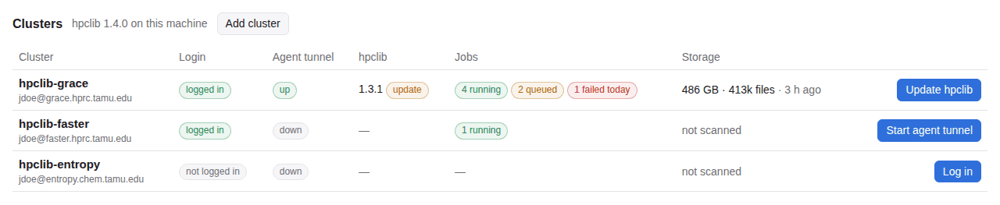

## A cluster's page

The cluster's name, at the left of the tabs, is a switcher: pick another cluster to see the same tab there.
Its address is `#/c/NAME/TAB`, so a tab can be bookmarked.

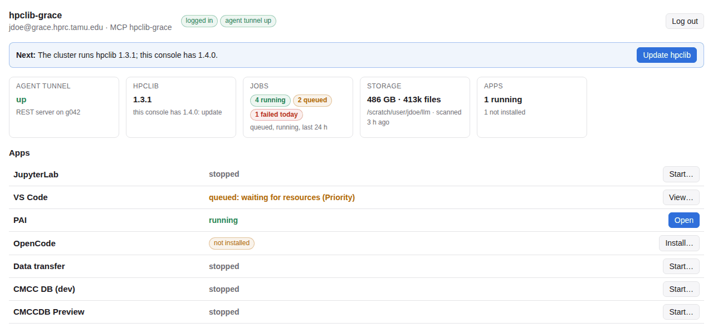

| Tab | What it shows |
| --- | --- |
| Overview | what the cluster needs next, tiles for the agent tunnel, hpclib, jobs, storage and apps, and each app's state with its one action |
| Jobs | every job of yours on the cluster, read with `squeue` and `sacct` over your login: queued (with Slurm's reason in plain words and the expected start), running, and finished in the last 24 hours (result, time taken, peak memory against what was asked for). Each job is labelled with what started it: an agent's template, the agent tunnel, an app, or something else |
| Apps | each app's row (Start, Open, Stop, Log), showing only the buttons that apply; a package's apps too. Click an app's name for its page |
| Installed | hpclib, the agent setup and each app: whether it is installed, what the cluster reported, and Check / Install / Update; **Check all** checks every app |
| Storage | the work directories' sizes and file counts, their largest folders, and your storage quota and project balance (**Check quotas**). **Scan now** runs `du` over your login at low priority, at most 5 minutes per directory (a longer scan is marked partial); the result is kept on this machine |
| Files | the cluster's files through its REST server (needs the agent tunnel), as the Files page was |
| Agents | **Tunnel and setup**: the agent profile's row (start and stop the agent tunnel, its log, Update hpclib, Setup…, Set up SSH), the MCP server's name, and **Tunnel actions** (what tunnels may do for agents with your access: on or off per tunnel and per action, and whether each can run now); **Activity**: what agents did here; **SSH keys** |
| Settings | the cluster's settings, in this order: its agent **Tunnel** (the tunnel's job), the REST **Server** (its limits and sandbox), **uv and pixi** (install them, and their Python and cache directories), ports (with **Clear leftover ports…**), **Quota checks**, **LLM clients** (its MCP entry in each client on this machine, with **Write entry**), and **Remove this cluster** |

### LLM clients

After the tunnel, server, port and quota settings, the Settings tab shows the cluster's MCP entry in each LLM
client installed here: whether the client has
it, an older one or none, and **Write entry** to add or update it (only this cluster's; Console Settings → LLM
clients writes every cluster's). An entry that starts the same server (the same URL, token and folders) with a
launcher of its own, such as `/usr/bin/arch -arm64 PYTHON`, counts as having it and is never rewritten by
**Write entries** or **Keep up to date**; **Use the console's launcher** replaces it. The card also says when the
launcher the console writes can't import the MCP SDK. The same list opens in setup's panel when setup finishes.

Above the list, what runs the server on this machine, changed without running setup again (nothing on the
cluster depends on it): **MCP launch command** (a Python with the `mcp` package, or a launcher such as
`/usr/bin/arch`), **Launch arguments**, the arguments before `rest_mcp.py`, separated by spaces (quote one that
contains spaces), e.g. `-arm64 /path/to/venv/bin/python`, and the agent's **local folders** (for `push_files` and
`pull_files`). **Save** writes `mcp.json` and the clients kept up to date. When a client already starts the
server its own way, **Use … 's launcher** makes that the console's too. Console Settings → Defaults for new
clusters suggests a launcher for new clusters. (Setup… holds only what the cluster needs.)

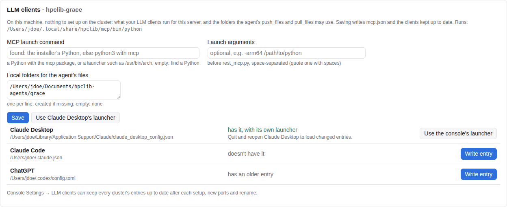

### Jobs

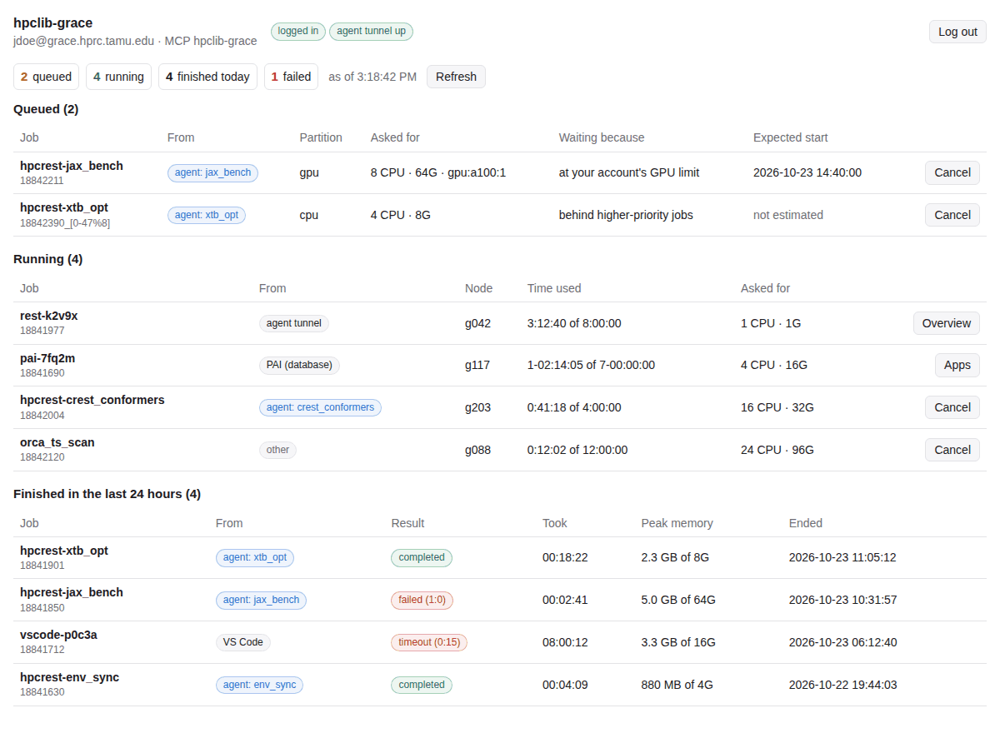

### Installed

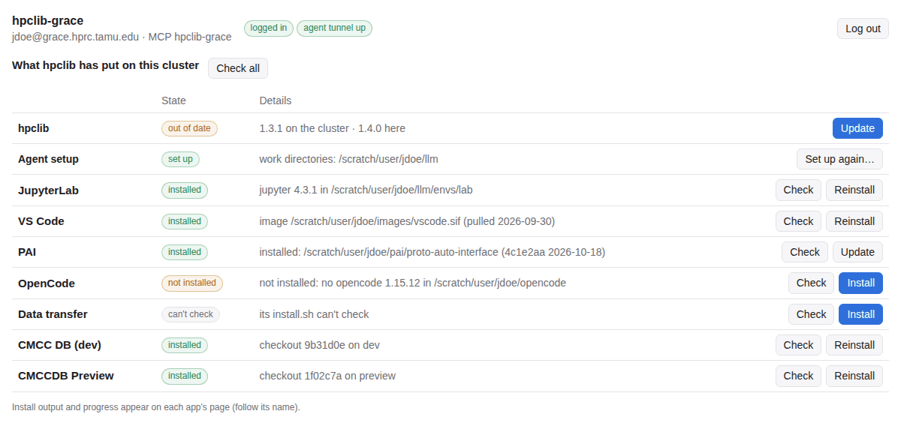

### Storage

How the quotas are checked, and changed, is [below](#quotas).

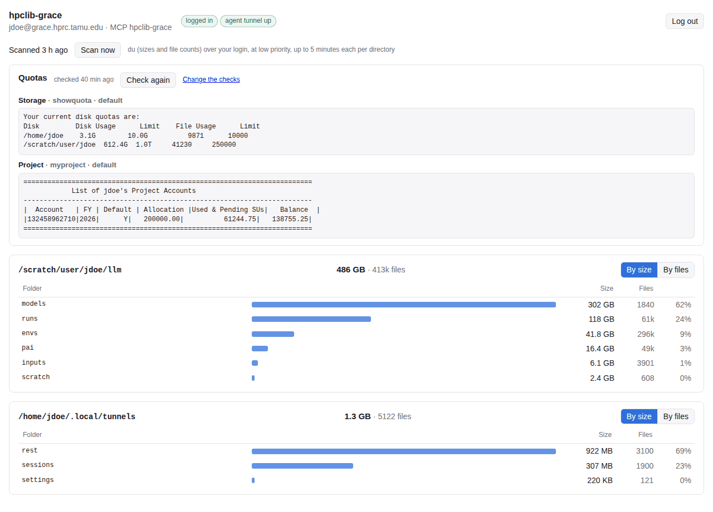

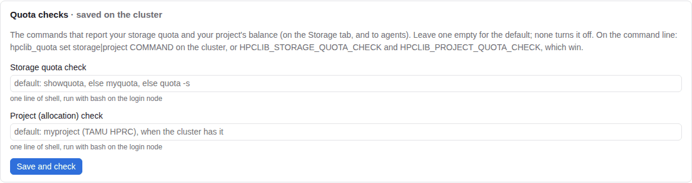

## An app's page

`#/c/NAME/apps/APP` is one app on one cluster: its row (Open, Start, Stop, Log, and its tools, such as PAI's
tokens), then its settings in place (what is installed, with Check and Install or Update; the job's options;
the app's own fields; its secrets). Install output appears under the row. When a package adds tabs to an app
(CMCC DB's Preview), they are tabs at the top of the app's page. **APP on all clusters** opens the app's old page,
one row per cluster.

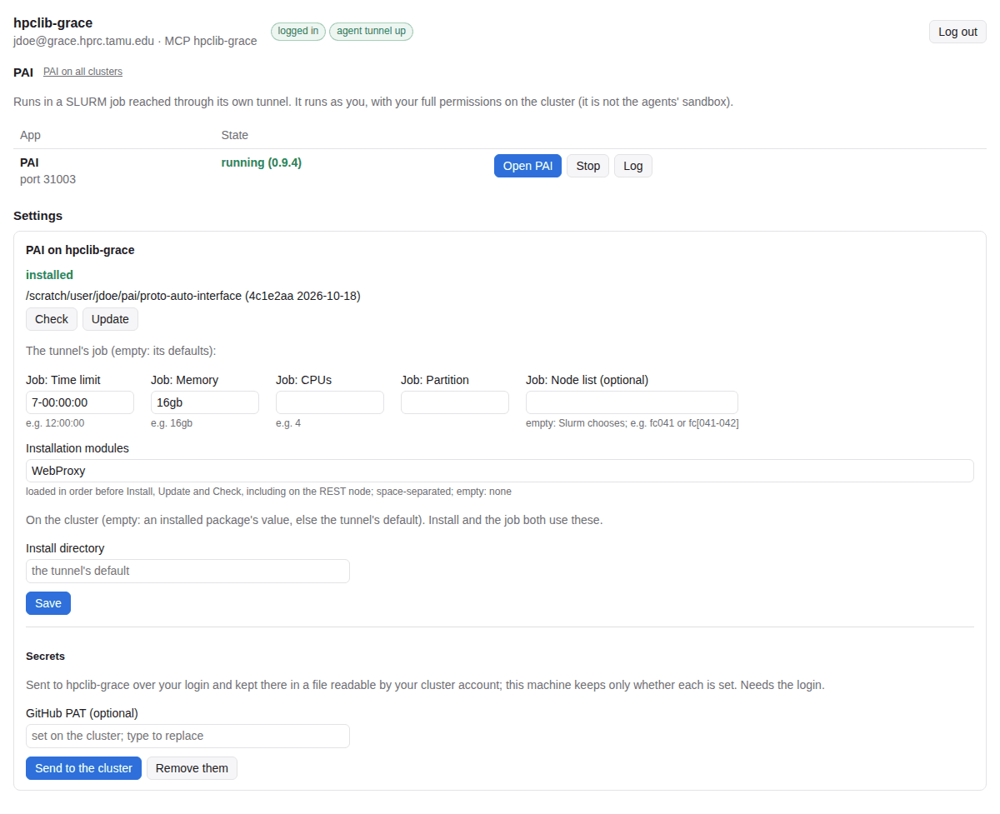

A package's tabs for an app (here CMCC DB's Preview) are tabs at the top of the app's page:

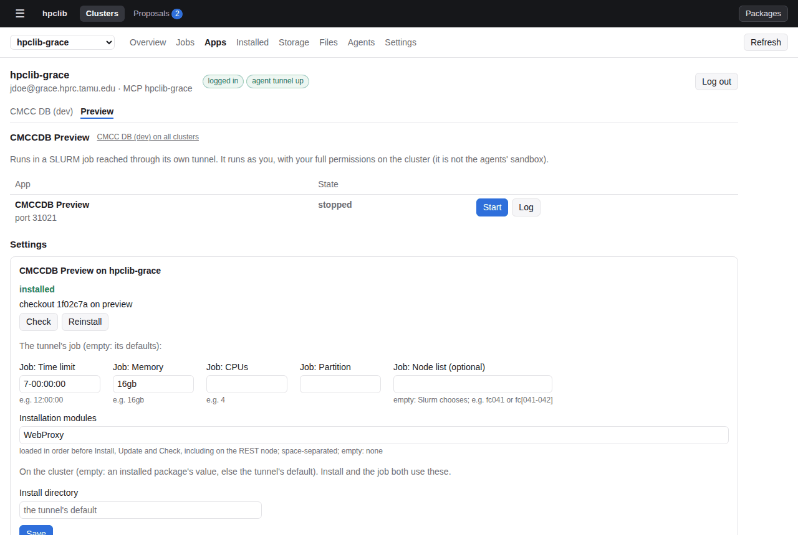

**Cancel** on the Jobs tab is offered for agents' jobs and jobs started outside hpclib. An app's job stops with
the app's **Stop**, PAI's database with **End database job**, and the agent tunnel with **Stop** on the
Overview.

Jobs are labelled from what hpclib puts on them: `hpcrest-TEMPLATE` names and the `hpclib-rest:TOKEN:TEMPLATE`
comment for agents' jobs, `TUNNEL-ID` names for tunnels. A job `job-queue` or you submitted yourself is "other".

### uv and pixi

**Settings → uv and pixi** shows whether uv and pixi are installed on the cluster (checked over your login) and
installs or updates either with its official installer (the login node needs the internet; your shell startup
files aren't changed). Below, where uv keeps the Pythons it downloads and where uv and pixi keep their package
caches: home directories are small, so a scratch directory is the usual place. Empty is the tool's default; the
directories are created when saved. When your `~/.bashrc` exports one, the card says so (it wins wherever
`~/.bashrc` is sourced), and **Fill in what ~/.bashrc sets** copies those values in. See
[uv and pixi](../cli/README.md#uv-and-pixi).

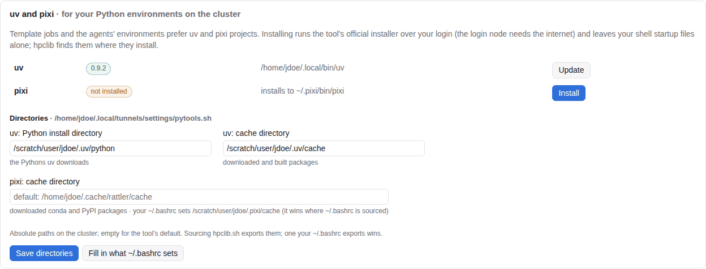

## Removing a cluster

**Remove this cluster**, at the end of its Settings tab, makes the console forget it: its profile (login, ports,
tokens, `mcp.json`) moves to `~/.config/hpclib/agents/.removed/`, from where moving the folder back restores it.
Before that it can revoke the cluster's agent token (with the agent tunnel up), stop its agent tunnel and apps, log
out, and take its MCP entry out of your LLM clients. hpclib, your files and the REST server's settings on the
cluster stay. On the command line: `agent_remove NAME` (it stops the agent tunnel and moves the profile).

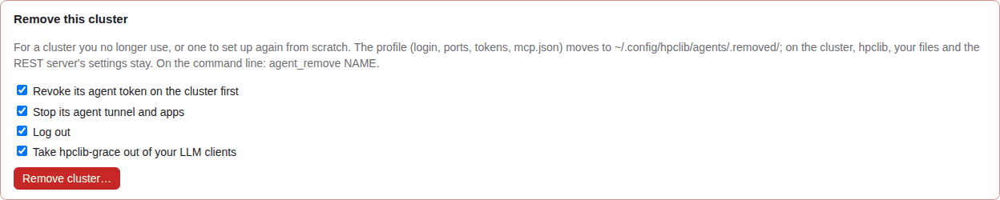

## Quotas

The quotas are two checks run over your login with the cluster's own commands: storage, the first of
`showquota`, `myquota` or `quota -s`; project, `myproject` (TAMU HPRC). **Settings → Quota checks** changes
them for a cluster that has other commands (empty: the default; `none`: off). They are saved on the cluster, so
`hpclib_quota` there, the REST server and agents' `check_quota` use them too; `HPCLIB_STORAGE_QUOTA_CHECK` and
`HPCLIB_PROJECT_QUOTA_CHECK` in the console's environment win. See [Quotas](../cli/README.md#quotas).
