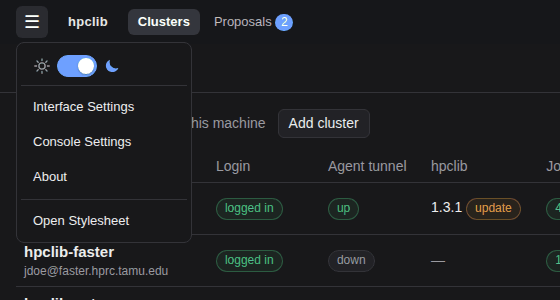
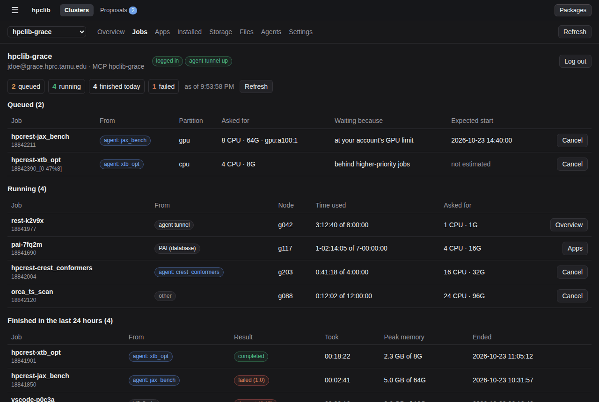
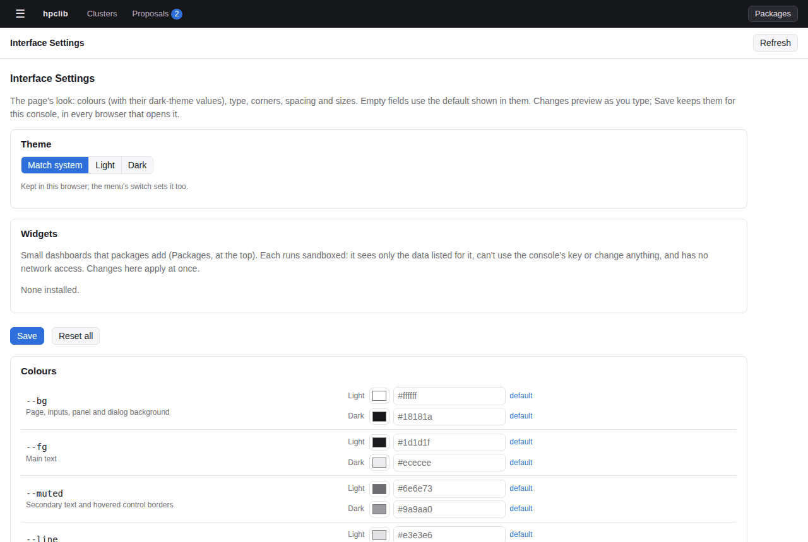
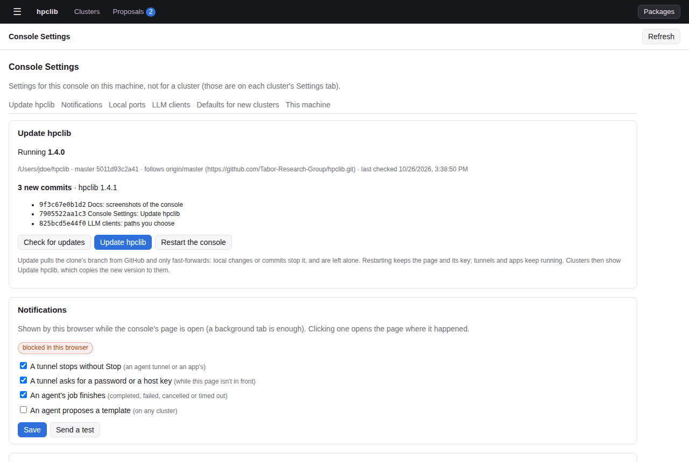
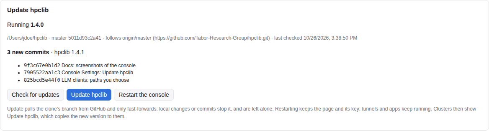
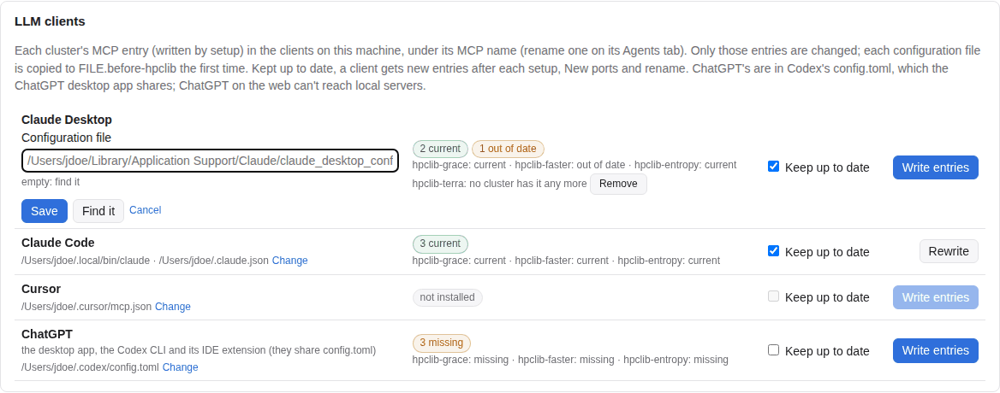
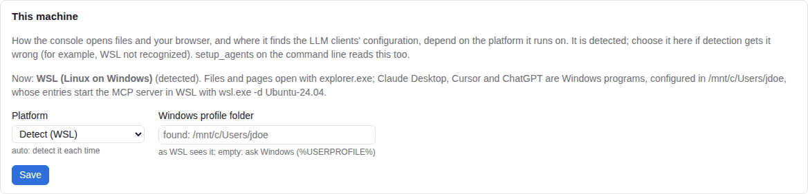
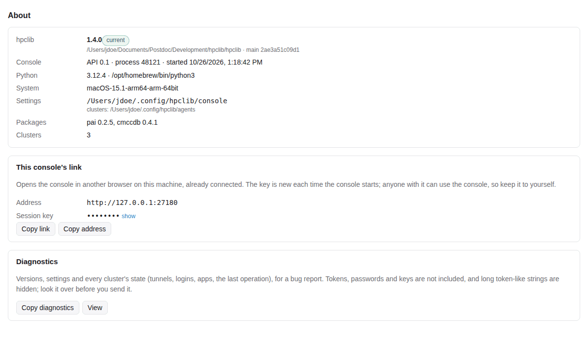

# The console menu

The **☰** menu at the top left holds what belongs to this console on this machine, not to a cluster.

## Dark mode

The switch at the top of the menu (sun, moon) picks the light or dark theme. Until you use it, the page follows
your system's setting; **Match system** goes back to that. The choice is kept in this browser.

## Interface Settings

Every variable of the page's stylesheet, grouped (colours, typography, corners, spacing, sizes) with what each one
changes. The colours that differ between themes have a light and a dark value. Empty fields use the default shown
in them. Changes preview as you type; **Save** keeps them for this console, in any browser that opens it, and
**Reset all** returns to the defaults.

**Widgets** lists the dashboards installed packages add (to the clusters page, each cluster's Overview, or a
tab of their own): show or hide each, and move it up or down within its place. Widgets run sandboxed: they see
only the data their package lists, can't use the console's key or change anything, and have no network access.
See [Console widgets](../extending.md#console-widgets).

For anything else, the page loads your own stylesheet, `user.css` (in `~/.config/hpclib/console/`), last:
**Open user.css** creates it from the defaults the first time and opens it in your editor. Where both set a
variable, `user.css` wins. **View the default stylesheet** shows the full set of defaults.

## Console Settings

| Section | What it does |
| --- | --- |
| Update hpclib | The hpclib this console runs (and the one on disk, if newer), its clone and the branch it follows. **Check for updates** fetches from GitHub and lists the commits an update brings; **Update hpclib** fast-forwards the clone to them (`git merge --ff-only`): files you changed or commits of your own stop it and are left as they are, and the card says what's in the way. **Restart the console** runs the new code in the same window, port and session (the page reloads; tunnels and apps keep running); it waits while a login, an operation or a storage scan runs. Clusters then show **Update hpclib** to copy the new version to them |
| Notifications | Browser notifications while the page is open (a background tab is enough): a tunnel stopping without **Stop**, a tunnel asking for a password or host key while the page isn't in front, an agent's job finishing, an agent proposing a template. The browser asks once whether to allow them. **Send a test** checks they appear. Clicking one opens the page where it happened |
| Local ports | Each tunnel listens on two ports on this machine, picked at random from a range (20000–32000 unless you change it). The table shows every tunnel's ports and whether each is free, held by its tunnel, or **taken by another program**. **New ports** picks new ones for a stopped tunnel; for an agent tunnel, it also changes the cluster's MCP entry |
| LLM clients | Which MCP entries (one per cluster, under its MCP name) Claude Desktop, Claude Code, Cursor and ChatGPT have: current, out of date (an old port, path or name), or missing. **Write entries** adds or updates them; **Keep up to date** does that after every setup, New ports and rename. Only the console's own entries are changed; a configuration file is first copied to `FILE.before-hpclib`. Claude Code's are added with its `claude mcp add-json --scope user`. ChatGPT's go in Codex's `~/.codex/config.toml` (or `$CODEX_HOME`'s), which the ChatGPT desktop app, the Codex CLI and its IDE extension share; other settings in that file, and an entry's own extra keys (timeouts, environment), are kept. ChatGPT on the web can't run local MCP servers. Under WSL, Claude Desktop, Cursor and ChatGPT are configured in your Windows profile, with entries that start the server through `wsl.exe` (marked "Windows, through wsl.exe"). Entries for clusters that are gone can be removed. **Change** under a client's path sets where its configuration file is (and Claude Code's `claude` program) when finding it gets it wrong; **Find it** goes back to finding it. On Windows, Claude Desktop's file is looked for in `%APPDATA%\Claude`, the Microsoft Store package's `%LOCALAPPDATA%\Packages\Claude_*\LocalCache\Roaming\Claude` and `%LOCALAPPDATA%\Claude-Data`; the newest one found is used |
| This machine | The platform the console runs on (detected: Linux, macOS, or WSL on Windows), which decides how it opens files and your browser and where the LLM clients' configuration is. Choose it if detection gets it wrong; `$HPCLIB_PLATFORM` wins over the choice. Under WSL, also your Windows profile folder as WSL sees it (`/mnt/c/Users/NAME`), found by asking Windows unless set here or in `$HPCLIB_WINDOWS_HOME`. See [Windows (WSL)](../installation.md#windows-wsl) |
| Defaults for new clusters | How long an idle login is kept, the work directory **Add cluster** suggests (`{user}` is the login's user), the local folder for agents' files that **Add cluster** and **Set up…** suggest (`{cluster}`, `{user}`; empty suggests none), the Python on this machine for MCP servers (empty: found; each cluster's **Set up…** can change it), the MCP server's name (default `hpclib-{cluster}`; `{cluster}` is the first part of the host name, `{host}` all of it, `{user}` the login's user), and the REST server's GPU mode and GPUs-per-job limit. A package's cluster configuration keeps its own values where it sets them |

**Update hpclib**, with three new commits on GitHub:

**LLM clients**, with **Change** open under Claude Desktop's path:

**This machine**, under WSL:

## A cluster's MCP name

What LLM clients call a cluster's MCP server is set on its **Agents → Tunnel and setup** page: letters, digits,
`-` and `_`, unique among your clusters, and not a name a client already uses for another server. Renaming
rewrites the cluster's `mcp.json`; clients kept up to date get the new name and lose the old one, and in the
others the old one shows as an entry no cluster has, with **Remove**. On the command line, `setup_agents
--mcp-name NAME` does the same for the profile.

## About

The hpclib this console runs, and the one on disk if it is newer (restart `launch-tunnel-manager` to use it);
Python, the system and the console's folders; installed packages. **Copy link** copies the console's address
with its session key, to open it in another browser on this machine. **Copy diagnostics** copies a report for a
bug: versions, settings and every cluster's state, without tokens, passwords or keys.

